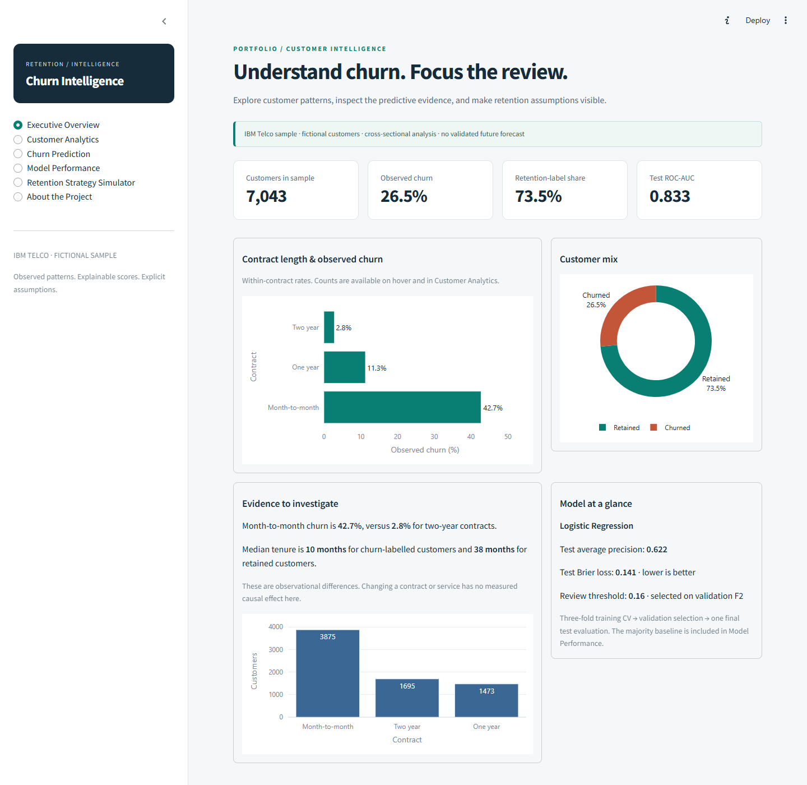
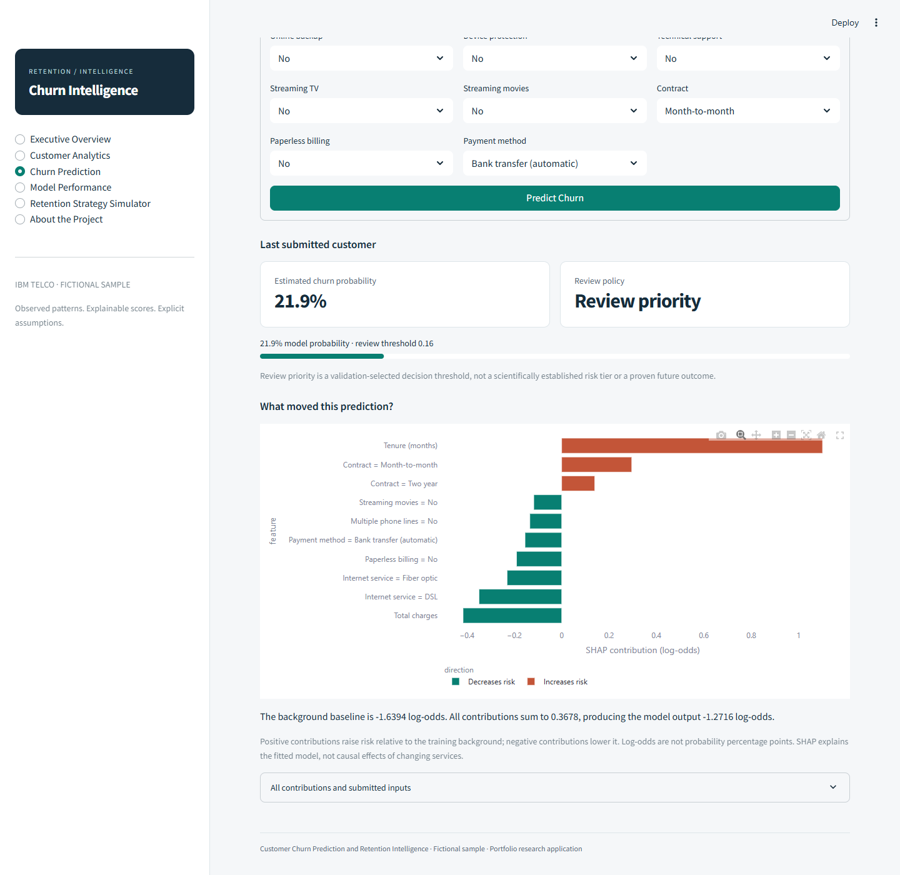
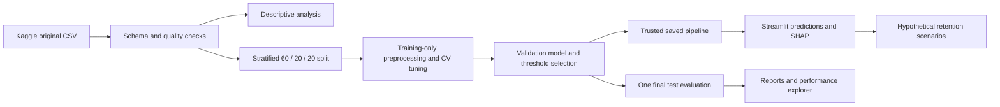

# Customer Churn Prediction and Retention Intelligence

A complete Python application for exploring fictional telecom churn, comparing predictive models, explaining individual scores and testing the arithmetic of retention scenarios.

The business question is where limited account-review attention might be most useful. The project separates observed customer patterns, held-out predictive evidence and hypothetical campaign assumptions.



## Results

The dataset contains 7,043 fictional customers; 1,869 (26.54%) have a churn label. The retention-label share is 73.46%.

Month-to-month customers have an observed churn rate of 42.71% (n=3,875), compared with 2.83% among two-year contracts (n=1,695). This association supports investigating contract-related segments; it does not show that changing contracts prevents churn.

Median tenure is 10 months among churn-labelled customers and 38 among retained customers. Mean monthly charges are 74.44 and 61.27, respectively, in dataset charge units. Tenure may reflect survivorship and the timing of label collection. Charges are not measured profit or lifetime value.

Selected model: **Logistic Regression**. Untouched test ROC-AUC **0.8327**, average precision **0.6223**, Brier loss **0.1414**. At validation-selected threshold **0.16**, precision is **44.36%**, recall **90.37%**, F1 **0.5951**, accuracy **67.35%**. These are held-out fictional-record results, not production forecasts.

### Candidate models: validation evidence

| model | cv_ap_mean | cv_ap_std | average_precision | roc_auc | brier | f1 | recall |
| --- | --- | --- | --- | --- | --- | --- | --- |
| Dummy | 0.2653 | 0.0003 | 0.2654 | 0.5000 | 0.1950 | 0.0000 | 0.0000 |
| Logistic Regression | 0.6615 | 0.0361 | 0.6779 | 0.8600 | 0.1302 | 0.6397 | 0.5909 |
| Random Forest | 0.6618 | 0.0320 | 0.6775 | 0.8586 | 0.1524 | 0.6514 | 0.7995 |
| Gradient Boosting | 0.6672 | 0.0271 | 0.6701 | 0.8552 | 0.1314 | 0.5872 | 0.5134 |

Classification columns use 0.50. CV is training-only and descriptive after tuning. Within 0.015 of best validation AP, then within 0.01 of minimum eligible Brier; prefer CV AP SD <= 0.04 where available; prefer logistic regression if eligible; otherwise highest AP. No test evidence used.

## Application

- Executive overview with observed KPIs and segment comparisons.
- Filterable customer analytics, service combinations and CSV export.
- Validated individual and batch prediction, probability display, review policy and signed SHAP contributions.
- Model comparison explorer, final test metrics, uncertainty, confusion matrix, ROC, PR and calibration plots.
- Retention scenario simulator with editable assumptions and explicit break-even arithmetic.
- About page, data provenance, model card and reproducible analytical report.



## Install and run on Windows 11

Requires Python 3.12 (64-bit recommended), about 1 GB free disk space for the environment, and no paid services. In PowerShell from this folder:

```powershell
py -3.12 -m venv .venv
.\.venv\Scripts\python.exe -m pip install -r requirements.lock.txt
.\.venv\Scripts\python.exe scripts/acquire_data.py
.\.venv\Scripts\python.exe -m src.train
.\.venv\Scripts\python.exe -m pytest -q
.\.venv\Scripts\python.exe -m streamlit run app/streamlit_app.py
```

The local delivery folder contains the verified dataset, trained artifacts and a local .venv. A GitHub clone includes trained artifacts but excludes the virtual environment and raw/processed customer CSVs; run the setup and acquisition commands above before launching it. Run `launch.ps1` once the environment is installed. Environment activation is optional. On Linux use `python3.12 -m venv .venv` and `.venv/bin/python` in place of the Windows executable. `requirements.txt` pins the direct dependencies; `requirements.lock.txt` pins the entire resolved Python environment. No keys are required.

Kaggle's public download endpoint is used. If authentication or a changed endpoint blocks acquisition, manually download the original CSV from the [dataset page](https://www.kaggle.com/datasets/blastchar/telco-customer-churn) into data/raw. Checksum mismatch fails explicitly; no synthetic fallback is used.

The publisher's data card displays “Data files © Original Authors” (checked 31 October 2026). The public repository links to the original instead of mirroring the raw or cleaned customer dataset. Code and original documentation use MIT; this does not relicense the source data.

## Architecture and workflow



Skills demonstrated: schema validation, exploratory statistics, leakage prevention, scikit-learn Pipeline/ColumnTransformer, stratified validation, efficient hyperparameter tuning, imbalance-aware evaluation, probability calibration assessment, SHAP, permutation importance, business scenario modelling, reusable Python modules, automated testing and Streamlit product design.

Technology: Python, pandas, NumPy, scikit-learn, SHAP, Plotly, Matplotlib, Streamlit, pytest. No GPU, paid API or subscription is required. Training uses one worker and small ensembles to suit an 8 GB laptop; models and data are loaded once with Streamlit caching.

```text
app/                 Six-page Streamlit application and styles
src/                 Data, features, analysis, training, evaluation, inference, explanations
scripts/             Dataset acquisition and verification utilities
data/raw/            Untouched Kaggle CSV
data/processed/      Deterministically cleaned analysis data
models/              Final pipeline, integrity manifest and model card
reports/             Generated findings, metrics, split manifest, curves and figures
assets/screenshots/  Genuine captures of the running app
tests/               Unit, integration, leakage and Streamlit tests
.streamlit/          Theme and deployment settings
```

All computed tables and charts are regenerated by `python -m src.train`. Seeds, split membership, search results, parameters, source checksum and artifact checksum are saved. Test rows are never used to tune, choose or refit a candidate. The app uses the exact saved preprocessing and model pipeline.

## Documentation

- [Analytical report](reports/analytical_report.md)
- [Data quality](reports/data_quality.md)
- [Model card](models/MODEL_CARD.md)
- [Deployment instructions](DEPLOYMENT.md)
- [Verification record](reports/verification.md)

## Responsible use and future work

The IBM sample is fictional and cross-sectional. Predictions are benchmark probabilities without prospective validation. Associations and SHAP values do not establish causes; scenario gains depend on unmeasured assumptions. No financial benefit or retention lift has been demonstrated. Inspect original dataset terms before redistributing or publicly publishing data. Code uses the MIT licence; source data remains subject to its publisher's terms.

Next steps for a real deployment include dated operational data, a temporal holdout, subgroup evaluation, prospective calibration monitoring, measured campaign costs and a randomised intervention trial. Nested CV could strengthen uncertainty estimates; the current bootstrap conditions on a fixed model. Public deployment and GitHub push require owner approval.
