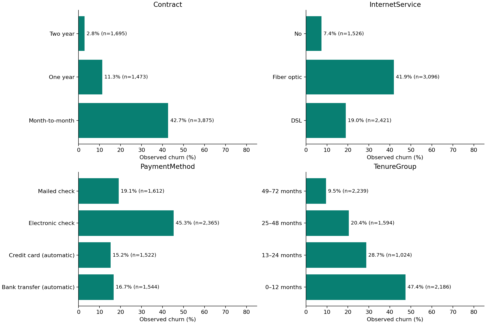
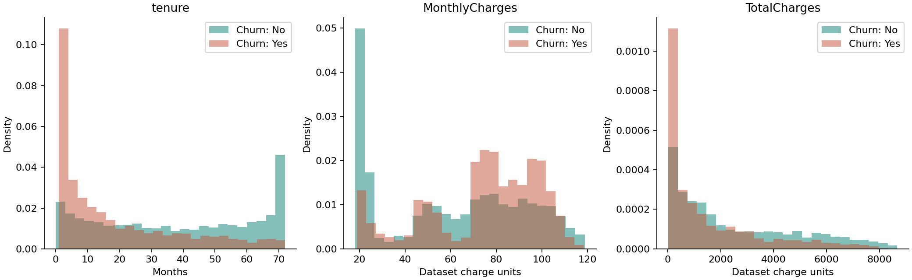
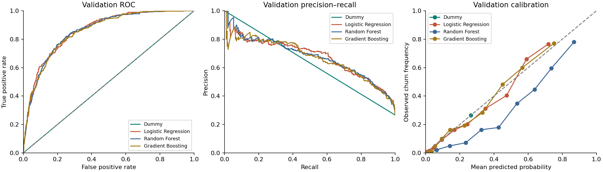
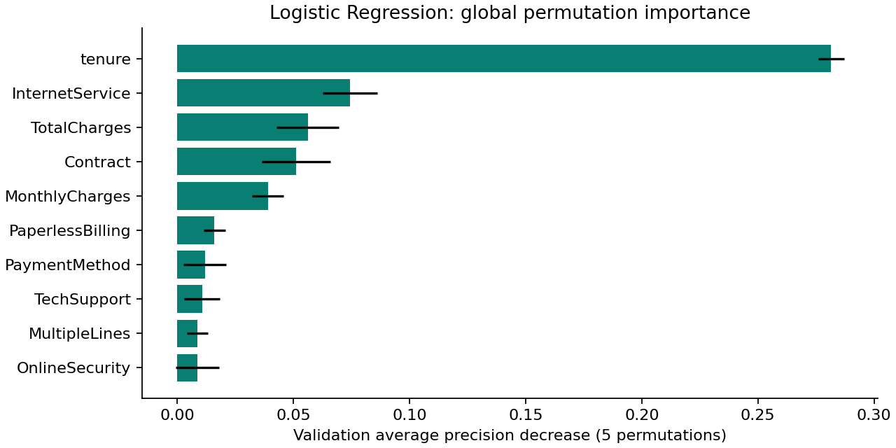

# Customer Churn Prediction and Retention Intelligence

## Executive summary

The fictional sample has 7,043 customer records and an observed churn-label share of 26.54%. Month-to-month contracts and shorter tenure warrant investigation because of their unadjusted associations with churn; neither establishes a causal retention lever.

The selected Logistic Regression model scores test ROC-AUC 0.8327, average precision 0.6223, and Brier loss 0.1414. At the validation-selected threshold 0.16, test precision is 44.36% and recall 90.37%. These measure discrimination and decision tradeoffs on held-out fictional records, not future production performance.

## Business problem

Retention teams have limited review capacity. A ranking can help prioritise account review, but predictive risk alone cannot establish who benefits from an offer. False positives consume review effort and can subsidise customers who would remain. False negatives miss labelled churners. The chosen F2 policy favours finding more labelled churners; campaign economics remain assumptions until measured in a controlled pilot.

## Dataset and methods

The original CSV was downloaded directly from the public [Kaggle Telco Customer Churn dataset](https://www.kaggle.com/datasets/blastchar/telco-customer-churn). It is an IBM sample containing fictional customer records. There are 7,043 rows, 21 fields and 19 predictors. The target is Churn, mapped Yes=1 and No=0. The file has no observation dates, verified deployment population, acquisition weights or intervention outcomes. Cross-sectional relationships cannot validate future churn forecasts.

SHA-256: `88be4b93fbe0cc83421af1c503794c97c342eca914c1576db7c276e61d61358a`. The raw file is unchanged. `reports/data_quality.json` records raw/parsed types, category levels, blanks, duplicate checks and numeric ranges. No exact duplicate records or duplicate IDs were found. All strict domain and service-consistency checks passed. Eleven TotalCharges cells contain whitespace and become missing values; all eleven have zero tenure. They are retained for training-fold imputation with an indicator. Missing counts derived before numeric parsing alone would conceal this issue. Deterministic whitespace and numeric parsing use no fitted statistics.

## Customer behaviour analysis

The dataset contains 7,043 fictional customers; 1,869 (26.54%) have a churn label. The retention-label share is 73.46%.

Month-to-month customers have an observed churn rate of 42.71% (n=3,875), compared with 2.83% among two-year contracts (n=1,695). This association supports investigating contract-related segments; it does not show that changing contracts prevents churn.

Median tenure is 10 months among churn-labelled customers and 38 among retained customers. Mean monthly charges are 74.44 and 61.27, respectively, in dataset charge units. Tenure may reflect survivorship and the timing of label collection. Charges are not measured profit or lifetime value.

The complete categorical analysis, including payment method, paperless billing, technical support, online security, senior status, partner/dependent status and all other available categories, is in `segment_analysis.csv`. Each category includes its denominator and churn count, preventing unsupported comparisons of small groups. These are exploratory unadjusted associations, not causal effects or independent confirmatory tests. Demographic features are included for benchmark transparency, not a recommendation to target protected or vulnerable groups.

[Customer behaviour evidence](customer_behaviour.md) provides every category's counts, rates, Wilson intervals, numerical comparisons and bounded business interpretation.

`numeric_by_churn.csv` contains counts, means, medians and standard deviations for tenure and charges, split by the observed label. `numeric_correlations.csv` records Pearson correlations among numerical variables; accumulated charges and tenure share structural dependence. `service_combinations.csv` cross-tabulates internet, support and security combinations, with counts and observed rates. These overlapping services can substitute for each other in predictive importance; a correlated feature with low importance need not be uninformative. Sparse combinations should be investigated rather than treated as stable policy groups.

## Machine learning methodology

All 19 native predictors are used; customerID and Churn are excluded from the feature matrix. No derived target proxies or post-label churn reasons are present in this version. Feature availability before a real decision is unverified, particularly accumulated charges and tenure. Prospective validation would require explicit observation and outcome windows.

Stratified random splitting with seed 42 gives 4,225 training, 1,409 validation and 1,409 test rows. Three-fold stratified cross-validation is restricted to training; four random hyperparameter configurations are tried per non-dummy candidate. Imputation, scaling and one-hot encoding are fitted separately within each training fold. Numerical scaling is retained for all candidates for one shared preprocessing definition; trees do not require scaling. Unknown categories can be encoded safely by the pipeline, while application validation rejects them to prevent unsupported decisions.

Numerical missingness uses training-fold median imputation with a missing indicator. No rows are deleted and no resampling is applied. Class weighting is a training-only candidate for logistic regression and random forest; probability calibration is assessed rather than assuming weighting improves probability estimates. Categories are one-hot encoded without ordinal assumptions.

Candidate selection: Within 0.015 of best validation AP, then within 0.01 of minimum eligible Brier; prefer CV AP SD <= 0.04 where available; prefer logistic regression if eligible; otherwise highest AP. No test evidence used. The selected pipeline remains fitted on the training set; it is not refitted after validation, preserving alignment between selected threshold, explanations and final evaluation. CV scores after hyperparameter selection are optimistic descriptive estimates, not nested-CV estimates. Validation and test evidence carry the selection and final assessment.

Threshold policy: Maximum validation F2 on 0.05–0.95 grid in 0.01 steps; higher threshold breaks ties. Review priority is a decision policy, not a validated clinical/business risk tier. This policy favours recall in a review workflow without claiming measured business costs. The probability is a model estimate; the binary label is the result of applying this policy. The scenario tool allows an alternative threshold without retraining or changing the recorded final evaluation.

## Model performance

Validation comparison below uses threshold 0.50 for classification metrics. AP is average precision; PR-AUC uses trapezoidal area and is separately exported. The constant-score dummy has an inflated trapezoidal PR area because the curve connects sparse endpoint values; average precision is the primary ranking criterion and matches prevalence for that baseline. Dummy predicts training prevalence for every row, illustrating the majority-class accuracy trap. Lower Brier loss is better.

| model | cv_ap_mean | cv_ap_std | average_precision | roc_auc | brier | f1 | recall |
| --- | --- | --- | --- | --- | --- | --- | --- |
| Dummy | 0.2653 | 0.0003 | 0.2654 | 0.5000 | 0.1950 | 0.0000 | 0.0000 |
| Logistic Regression | 0.6615 | 0.0361 | 0.6779 | 0.8600 | 0.1302 | 0.6397 | 0.5909 |
| Random Forest | 0.6618 | 0.0320 | 0.6775 | 0.8586 | 0.1524 | 0.6514 | 0.7995 |
| Gradient Boosting | 0.6672 | 0.0271 | 0.6701 | 0.8552 | 0.1314 | 0.5872 | 0.5134 |

Only the selected model was evaluated on the test set. Final metrics use threshold 0.16; candidate classification columns above use 0.50 and should not be compared directly without matching thresholds.

| Test metric | Estimate | 95% bootstrap interval |
| --- | --- | --- |
| roc_auc | 0.8327 | 0.8124–0.8522 |
| average_precision | 0.6223 | 0.5720–0.6754 |
| brier | 0.1414 | 0.1323–0.1517 |
| recall | 0.9037 | 0.8747–0.9309 |
| precision | 0.4436 | 0.4076–0.4800 |
| f1 | 0.5951 | 0.5617–0.6290 |
| accuracy | 0.6735 | 0.6487–0.6991 |

Test trapezoidal PR-AUC is 0.6212. Confusion matrix, with actual rows [retained, churned] and predicted columns [below threshold, review priority], is `[[611, 424], [36, 338]]`. Validation metrics at the selected threshold are precision 0.4401, recall 0.9332, and F1 0.5981.

Intervals use 500 seeded customer-level nonparametric bootstrap draws of fixed test predictions and percentile limits (2.5th, 97.5th). They quantify test-sample variation conditional on the fitted model, split and policy; they omit training, tuning, threshold-selection uncertainty and distribution shift. Quantile-bin calibration curves show empirical frequencies and may be noisy in small bins. No post-hoc probability calibrator was fitted. The app displays the saved final curves without using test data to change the model.

## Important predictors

Top validation permutation features are tenure, InternetService, TotalCharges, Contract, MonthlyCharges. Importance is the decrease in average precision when an original feature is shuffled, averaged over five permutations; bars show permutation standard deviations, not confidence intervals. Negative values reflect finite-sample variation. Correlation can dilute or redistribute importance.

Individual SHAP values use the actual fitted model and transformed training background (80 training rows). Logistic regression uses LinearExplainer; tree candidates use interventional TreeExplainer. Explanations sum to the saved model output, verified numerically. Positive values raise risk relative to the background baseline; negative values lower it. Log-odds contributions are not percentage-point probability changes. Preprocessing indicator and one-hot features appear explicitly. These describe model associations, not interventions or causes.

## Retention decision scenarios

For illustration on the 1,409 held-out test records, threshold 0.16 flags 762 customers. Assuming contact cost 10, customer contribution value 200 and effectiveness 20%, estimated spend is 7,620.00 and conditional net contribution 6,232.66, in hypothetical currency units.

Expected labelled churn = sum of flagged probabilities. Assumed saved customers = expected labelled churn × assumed effectiveness. Scenario benefit = assumed saved × hypothetical contribution value. Net = benefit − contact spend; ROI = net/spend where spend is nonzero. This assumes probability transferability, uniform intervention effects, no contact harms and no overlapping campaigns. Value should represent incremental contribution after fulfilment costs; contact cost must include offer expense. None of these assumptions is estimated by the dataset. The cross-sectional target has no validated future outcome horizon, so these figures are conditional arithmetic, not a revenue forecast.

## Recommendations

1. Investigate month-to-month and early-tenure segments with customer interviews and service-quality evidence; their observed differences motivate hypotheses, not automatic contract changes.
2. Validate the ranking on dated, consented operational data using a forward-looking outcome window, availability checks and temporal holdout before any production use.
3. Measure calibration, workload and errors in a monitored pilot. Establish review capacity and actual error costs before setting a production threshold.
4. Randomise retention outreach against a control group to estimate incremental benefit and contact harms. Replace scenario effectiveness with experimental lift only when defensible.
5. Audit performance and interventions across demographic groups. Avoid using age or gender as an unsupported eligibility rule.

## Limitations and conclusion

The sample is fictional, cross-sectional and not a representative production population. Labels do not establish a valid future forecast horizon; no causal retention effects, lifetime value or real financial gains are observed. Random holdout performance can overstate transfer to new periods or operators. No formal subgroup fairness audit, temporal validation, drift monitor or external validation has been performed. The application is a reproducible portfolio and review tool; operational deployment requires additional evidence, governance and monitoring.
